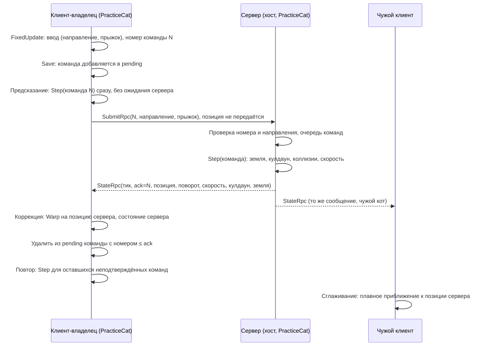

# ПР‑4. Client-Side Prediction и Server Reconciliation

## 1. Общие сведения

| Поле | Значение |
|---|---|
| Проект | «Коты на крыше» — сетевой 3D-прототип, 2–3 игрока |
| Команда | Катя (Mac 2, хост), Арина (Windows), Ваня (Mac 1) |
| Движок | Unity **6000.3.10f1**, Netcode for GameObjects **2.7.0**, Unity Transport |
| Модель | Listen Server: один игрок является хостом и сервером, остальные подключаются клиентами |
| Коммит для демонстрации | `e3880e9` — слияние PR #1 (`feature/prediction` → `main`). Код движения (`PracticeCat.cs`) вошёл в `main` этим коммитом. Актуальный хеш проверяйте командой `git log -1 --format=%h` |
| Артефакты | Кадры и журналы лежат в [media](media): [без предсказания](media/baseline_no_prediction.png), [с предсказанием](media/prediction_enabled.png), [после коррекции](media/correction_example.png), [журнал](media/prediction-results.txt) |

**О стеке.** Методичка написана для Unreal Engine. Проект сделан на Unity, поэтому терминология сопоставлена ниже (раздел 3). В Unity нет готового аналога `CharacterMovementComponent` с сохранёнными ходами, поэтому предсказание и коррекция реализованы вручную в [`PracticeCat.cs`](../Assets/Rooftop/Scripts/PracticeCat.cs) поверх `CharacterController`.

## 2. Поток данных

То же в виде таблицы:

| Шаг | Где | Что происходит | Код |
|---|---|---|---|
| 1. Ввод | Клиент-владелец | Каждый физический шаг собирается ввод: направление и флаг прыжка. Команде присваивается порядковый номер | `FixedUpdate`, структура `Move` |
| 2. Сохранение | Клиент-владелец | Команда добавляется в список неподтверждённых `pending` (аналог Saved Move) | `pending.Add(move)` |
| 3. Предсказание | Клиент-владелец | Если включена галочка «Предсказание своего кота», команда сразу применяется локально | `if (Prediction) Step(move)` |
| 4. Отправка | Клиент → сервер | Отправляется только намерение: номер, направление, прыжок. Итоговая позиция не передаётся | `SubmitRpc` |
| 5. Проверка | Сервер | Проверяется номер команды и корректность направления, команда ставится в очередь. Один ход обрабатывается за один физический шаг | `SubmitRpc`, `FixedUpdate` |
| 6. Применение | Сервер | Сервер сам считает движение, проверяет землю и кулдаун прыжка, коллизии | `Step` |
| 7. Подтверждение | Сервер → клиенты | Сервер шлёт тик, номер последней обработанной команды (`ack`), позицию, поворот, вертикальную скорость, остаток кулдауна и признак «на земле» | `StateRpc` |
| 8. Коррекция | Клиент-владелец | Клиент возвращается к авторитетному состоянию, удаляет подтверждённые команды | `Warp(position)`, `pending.RemoveAll` |
| 9. Повтор | Клиент-владелец | Неподтверждённые команды проигрываются заново поверх состояния сервера | `foreach (command in pending) Step(command)` |
| 10. Чужие коты | Остальные клиенты | Позиция приходит с сервера, отображение плавно догоняет её | `Update`: `Vector3.Lerp`, `Quaternion.Slerp` |

## 3. Роли компонентов (сопоставление с Unreal Engine)

| Unreal Engine | В проекте | Что делает |
|---|---|---|
| Server authority | Хост (`IsServer`) | Единственный, кто принимает окончательное решение о состоянии кота и рыбок. Клиент не передаёт позицию |
| GameMode | Отдельного класса нет. Запуск сессии и создание рыбок: [`RoofConnection`](../Assets/Rooftop/Scripts/RoofConnection.cs). Создание игроков: `NetworkManager` (префаб игрока) | Правила матча (раунд, таймер, счёт) пока не подключены, это модуль Вани |
| PlayerController | Часть `PracticeCat` для владельца (`IsOwner`) | Считывает клавиатуру (`Input.GetAxisRaw`, пробел), формирует команды и отправляет `SubmitRpc` |
| Character | [`PracticeCat`](../Assets/Rooftop/Scripts/PracticeCat.cs) и [`CatInventory`](../Assets/Rooftop/Scripts/CatInventory.cs) | Состояние кота: вертикальная скорость, кулдаун, признак земли; перенос одной рыбки |
| CharacterMovementComponent | `PracticeCat.Step` + `CharacterController` | Расчёт шага движения, одинаковый на сервере и на клиенте (иначе предсказание не совпадало бы). Сохранение ходов, коррекция и повтор реализованы в `PracticeCat` вручную |
| Autonomous Proxy | Свой кот на клиенте (`IsOwner`, не сервер) | Предсказывает движение и принимает коррекции |
| Simulated Proxy | Чужой кот на клиенте (не владелец, не сервер) | Получает позицию с сервера и сглаживает её |
| Saved Move | Структура `Move` в списке `pending` | Команда, которую можно проиграть заново после коррекции |
| Network smoothing | `Update` в `PracticeCat` | Экспоненциальное сглаживание позиции и поворота чужих котов |
| Рыбки | [`RoofFish`](../Assets/Rooftop/Scripts/RoofFish.cs) | Подбор принимает только сервер, второй рыбки кот взять не может |

## 4. Выбранное действие и серверные проверки

**Действие:** прыжок через центральный воздуховод с ограничением повторного использования (кулдаун 3 секунды). Это вариант «прыжок с ограничением повторного использования» из методички.

Сервер проверяет:

| Проверка | Где | Что отклоняется |
|---|---|---|
| Номер команды больше последнего принятого | `SubmitRpc` | Повторные и пришедшие не по порядку команды |
| Компоненты направления — конечные числа, длина вектора ограничена единицей | `SubmitRpc` | `NaN`, бесконечность, ускоренное движение за счёт длинного вектора |
| Размер очереди не больше 100 команд | `SubmitRpc` | Переполнение очереди |
| Один ход за физический шаг, скорость ограничена | `FixedUpdate`, `Step` | Движение быстрее допустимого |
| Кот стоит на земле (`grounded`) | `Step` | Прыжок в воздухе |
| Кулдаун закончился (`cooldown <= 0`) | `Step` | Прыжок раньше трёх секунд |
| Коллизии `CharacterController` | `Step` | Проход сквозь воздуховод и парапеты |

Клиент не может приказать серверу «я нахожусь в точке X». Сервер получает только направление и запрос прыжка и сам вычисляет результат. Поэтому телепортация невозможна, а ошибка предсказания исправляется коррекцией.

## 5. Без предсказания и с предсказанием

Условия: Unity development build на macOS, хост и клиент в отдельных процессах, задержка 100 мс **в одну сторону** (≈200 мс круговая) без потерь, посредник [`Tools/udp_lab.py`](../Tools/udp_lab.py). Данные: [журнал](media/prediction-results.txt).

| | Без предсказания (`baseline`) | С предсказанием (`prediction`) |
|---|---|---|
| Реакция кота на нажатие | Кот поднимается только после ответа сервера | Кот поднимается в том же шаге ввода (`LOCAL_JUMP`, высота 1,194 м сразу) |
| Время до подтверждения сервером | 283, 282 и 275 мс (три прыжка) | 249–253 мс (подтверждение приходит так же поздно, но кот уже в воздухе) |
| Неподтверждённых команд при подтверждении | 13 | 12 |
| Поведение сервера | Принял допустимые прыжки, отклонил ранний (`REJECT`) | То же |

Главный вывод: предсказание не ускоряет сервер, а убирает задержку из ощущения управления. Время подтверждения почти не изменилось, но игрок видит прыжок сразу. Кадры: [без предсказания](media/baseline_no_prediction.png) (на панели «Ожидание сервера») и [с предсказанием](media/prediction_enabled.png) (`LOCAL_JUMP #149`).

## 6. Случай расхождения и серверная коррекция

Расхождение создаётся намеренно. На клиенте с предсказанием нажимается **F8** во время кулдауна: клиент обнуляет локальный кулдаун (флаг `simulateEarly`) и прыгает «в нарушение правил». Этот флаг **не передаётся серверу**: сервер получает обычную команду прыжка и сам проверяет кулдаун.

Что происходит в журнале при задержке 100 мс (команда №218):

1. `INPUT #218` — игрок нажал ранний прыжок.
2. `LOCAL_JUMP #218` — клиент поднял кота, не дожидаясь сервера (ошибка предсказания).
3. Сервер: `REJECT #218` — кулдаун ещё не закончился, прыжок отклонён, высота остаётся 1,080.
4. Клиент: `ACK #218 after_ms=253 delta_y=-0.978 replay=12 server_y=1.080` — через 253 мс приходит состояние сервера, клиент опускается на 0,978 м, принимает позицию сервера и повторяет 12 неподтверждённых команд.
5. Соединение не разорвано, игра продолжается (далее выполняется допустимый прыжок через воздуховод, `VENT_OK`).

Кадр на момент коррекции: [correction_example.png](media/correction_example.png).

## 7. Ссылки и известные ограничения

**Код:** [`PracticeCat.cs`](../Assets/Rooftop/Scripts/PracticeCat.cs) (движение, предсказание, коррекция), [`RoofConnection.cs`](../Assets/Rooftop/Scripts/RoofConnection.cs) (запуск сессии, переключатель предсказания), [`PracticeProbe.cs`](../Assets/Rooftop/Scripts/PracticeProbe.cs) (автоматический сценарий проверки), [`Tools/check_practice.py`](../Tools/check_practice.py) и [`Tools/udp_lab.py`](../Tools/udp_lab.py) (запуск и эмуляция сети).

**Тесты:** [Prediction_Test_Matrix.md](Prediction_Test_Matrix.md).

**Ограничения:**
- Эмуляция сети сделана самописным UDP-посредником на localhost, а не встроенными средствами движка. Задержка применяется в обе стороны, потери — в обе стороны.
- Потери включаются после подключения клиента. В отдельной попытке с потерями с первого пакета клиент не смог войти за 50 секунд (сцена не синхронизировалась).
- Ручные проверки на Windows и на нескольких реальных машинах в локальной сети в этом документе не отражены.
- Сглаживание чужих котов использует фиксированный коэффициент, отдельно его качество при потерях не измерялось.
- Модуль матча (коробки, счёт, таймер) пока не подключён, игрок отображается капсулой.
